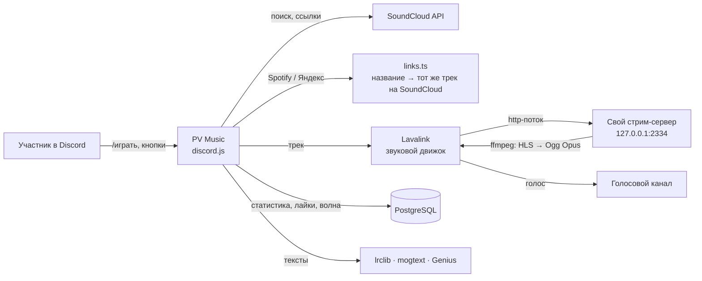

# 🎶 PV Music

Музыкальный бот для Discord-сервера «Потный Вафелс». Играет музыку в голосовых каналах, подбирает бесконечную «Мою волну» под вкус человека, показывает плеер-картинку и находит тексты песен.

Собран за пару дней в связке **Claude Code + Codex**: я ставил задачи, проверял результат и автотесты, ИИ писал код. Как именно устроена работа с ИИ — в [`docs/AI-WORKFLOW.md`](docs/AI-WORKFLOW.md).

> Это отдельный модуль большого проекта **PV Bot** (TypeScript, ~47 000 строк, 210+ файлов, 80 наборов автотестов). Основной репозиторий закрыт — в нём данные участников и настройки живого сервера. PV Music вынесен сюда целиком и работает самостоятельно.

**Лендинг сервера:** [открыть сайт](https://summer2134.github.io/pv-music/) · [`landing/index.html`](landing/index.html) — сделан в Claude Code, живой «чат» с ботом на первом экране, покрыт e2e-тестами на Playwright.

---

## Что умеет

| | |
|---|---|
| ▶️ **/играть** | название или ссылка: SoundCloud, Spotify, Яндекс Музыка, YouTube, mp3. Плейлисты и альбомы до 25 треков, подсказки прямо при вводе |
| 🌊 **Моя волна** | бесконечная подборка «как в Яндекс Музыке»: учится на ❤️ и 👎, на пропусках и дослушанных треках, подмешивает вкус друзей в войсе. Настройки: занятие, настроение, характер, язык |
| 🖼️ **Плеер-картинка** | обложка, название, полоска времени — PNG рисуется на сервере, обновляется раз в 15 с. Всё управление кнопками: пауза, перемотка ±10 с, громкость, очередь, повтор |
| 📝 **Тексты песен** | lrclib → mogtext → Genius → lyrics.ovh, сверка исполнителя, сама размечает куплеты и припевы |
| 🔒 **Управляет заказавший** | чужой не переключит твой трек; ушёл из войса — управление свободно |
| 📊 **Статистика** | топ сервера, кто сколько слушал, ачивки за музыку в основном боте |
| 🛠️ **Админка без панелей** | команды `!!!` текстом в чат: статус, самопроверка звука по шагам, обновление с GitHub, перезапуск. Бот сам обновляется, когда музыка нигде не играет, и пишет владельцу в ЛС |

## Как устроено



**Самое интересное инженерно:**

- **Свой SoundCloud-стриминг.** Встроенный SoundCloud в Lavaplayer перестал понимать форматы, YouTube блокирует IP дата-центров. Решение: бот сам ходит в API SoundCloud (client_id берётся со страницы сайта и обновляется на 401/403), выбирает формат без DRM, а звук отдаёт через свой локальный HTTP-сервер — ffmpeg перегоняет HLS в Ogg Opus, Lavalink играет это как обычную ссылку. Запасные пути: свежая авторизация трека и yt-dlp. → [`src/soundcloud.ts`](src/soundcloud.ts)
- **Перемотка там, где её нет.** У такого потока нельзя сделать seek, поэтому бот открывает новый поток с нужной секунды (`ffmpeg -ss`), подменяет трек незаметно для очереди и хранит сдвиг времени для карточки. → `seekTo` в [`src/player.ts`](src/player.ts)
- **Рекомендации без ML.** «Моя волна» — кандидаты из «похожих» SoundCloud и тегов настроения, скоринг по оценкам, популярности, разнообразию исполнителей, фильтры по языку и дизлайкам. → [`src/wave.ts`](src/wave.ts)
- **Тексты без API.** У Genius нет текстов в API, а сервер он не пускает (403) — поэтому цепочка источников, проверка исполнителя (чтобы не подсунуть одноимённую песню другого артиста) и автоматическая разметка куплетов по повторам. Диагностика `!!!текст` показывает, что ответил каждый источник. → [`src/lyrics.ts`](src/lyrics.ts)
- **Устойчивость.** Упала база — музыка играет, статистика просто не пишется. Упал Lavalink — бот переподключается сам. Обновление только когда никто не слушает, защита от бесконечных перезапусков.

## Автотесты

Каждая фича закрыта тестом **до** выкладки. Discord, Lavalink, SoundCloud, ffmpeg и systemd в тестах подменены — сеть и ключи не нужны.

```bash
npm ci
npm test            # сборка + 5 наборов тестов
DATABASE_URL=postgres://… npm test   # + тест базы (плейлисты, лайки, статистика)
```

| Набор | Что проверяет |
|---|---|
| `smoke-music-play` | `/играть`, очередь, все кнопки плеера, права «управляет заказавший», перемотка SoundCloud, волна, Spotify-ссылки, текст песни |
| `smoke-music-links` | разбор ссылок Spotify (embed, короткие spotify.link, запасной путь) и Яндекс Музыки (API, альбомы, плейлисты, закрытый API) |
| `smoke-music-lyrics` | цепочка источников, отказ Genius (403), чужая песня с тем же названием отброшена, разметка куплетов |
| `smoke-music-stream` | client_id, выбор формата без DRM, поток через подставной ffmpeg, 502 при ошибке, запасной yt-dlp |
| `smoke-music-admin` | `!!!`-команды: кто может, ответ в ЛС, перезапуск с меткой |
| `smoke-music` | PostgreSQL: статистика прослушиваний, плейлисты, лайки, лимиты |

**e2e лендинга на Playwright** — 5 сценариев × компьютер и телефон: первый экран без ожидания, «бот печатает → отвечает», лимит сообщений в чате, нет горизонтальной прокрутки, копирование приглашения.

```bash
npx playwright install chromium
npm run test:e2e
```

Всё это гоняется на каждый пуш в GitHub Actions ([`ci.yml`](.github/workflows/ci.yml)): юнит/интеграционные — с настоящим PostgreSQL, e2e — в Chromium. Лендинг сам выкладывается на GitHub Pages ([`pages.yml`](.github/workflows/pages.yml)).

## Стек

TypeScript (ESM) · Node.js 22 · Playwright (e2e) · discord.js 14 (Components V2) · Lavalink v4 + lavalink-client · PostgreSQL · resvg (SVG → PNG) · ffmpeg · systemd на своём VPS

## Запуск

Нужны Node.js 22, PostgreSQL, Java 17+ (для Lavalink) и ffmpeg. Подробно, с установкой одной командой на Ubuntu — [`docs/DEPLOY.md`](docs/DEPLOY.md).

```bash
cp .env.example .env    # токен бота, база, пароль Lavalink
npm ci && npm run build
npm start
```

---

Автор — Серафим.
